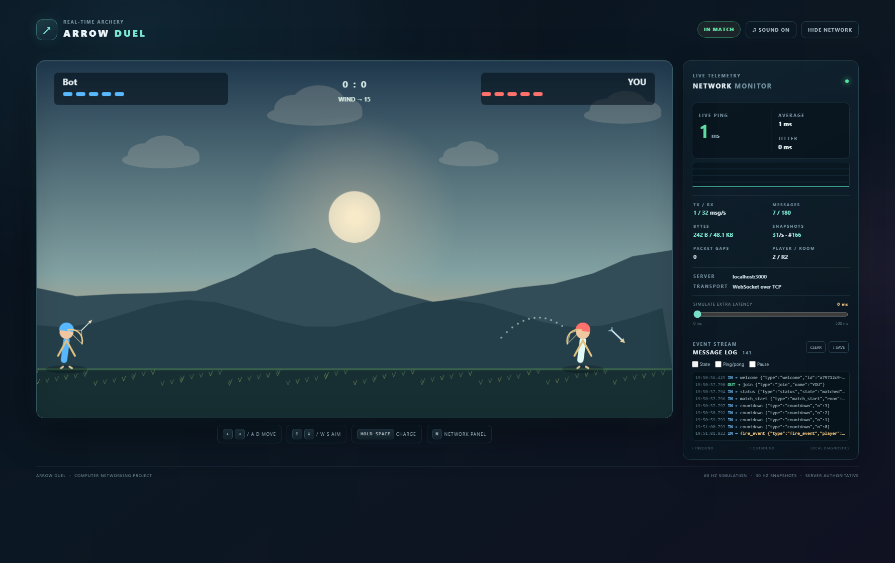

# Arrow Duel



Arrow Duel is a two-player real-time browser archery game for a computer networking project. Each browser sends small input intents to a Node.js referee. The server pairs players, runs isolated matches, simulates movement, charge, projectiles, wind and hit detection, and broadcasts snapshots. The page draws every visual procedurally and synthesizes sound locally, so play makes no third-party runtime requests.

## Requirements and run
Use Node.js 18 or newer.
1. On laptop A, open a terminal in this arrow-duel folder.
2. Run npm install.
3. Run npm start. The server listens on all interfaces at port 3000 and prints Local and available LAN URLs.
4. On laptop A, open http://localhost:3000.
5. On laptop B, connect to the same Wi-Fi or hotspot and open the LAN URL printed on laptop A, such as http://192.168.1.23:3000. Laptop B needs only a browser.
6. Enter names and press Find Match on both browsers. For a practice opponent, run npm run bot in another terminal.

Choose another port with PORT=3001 npm start on macOS/Linux or $env:PORT=3001; npm start in PowerShell.

## Firewall and network setup
- Windows: allow Node.js on Private networks in Windows Defender Firewall, or in elevated PowerShell run: netsh advfirewall firewall add rule name="ArrowDuel" dir=in action=allow protocol=TCP localport=3000.
- macOS: approve incoming connections for Node when prompted and confirm the active network firewall permits TCP 3000.
- Linux: with UFW, run sudo ufw allow 3000/tcp.

Find the host address manually with ipconfig (Windows), ifconfig (macOS, if installed), or ip a (Linux). Choose the IPv4 address of the active adapter, not 127.0.0.1. Both laptops must be on a reachable network. Guest/public Wi-Fi may isolate devices; use a phone hotspot. Temporarily disconnect a VPN that blocks local traffic. Verify the IP, port, firewall, and router client-isolation setting if the page does not load. Change PORT if 3000 is occupied.

## Controls and rules
- Left/right arrows or A/D move within your half.
- Up/down arrows or W/S adjust angle.
- Hold Space to charge; release to shoot.
- M or the sound button toggles sound. N toggles the network panel.
- Five health points; body hits deal one, head hits two. Wind changes each round. Both players act at once.
- Power starts at 15 and rises to 100 over 1.2 seconds. Shots have a 0.7-second cooldown.

## Architecture
```
┌──────────────┐    WebSocket / TCP     ┌──────────────────────────────────┐
│  Browser A   │ <--------------------> │ Node.js: matchmaking, rooms,      │
│ canvas + UI  │                         │ authoritative referee, 60 Hz sim │
└──────────────┘                         │ and 30 Hz snapshots               │
                                         └──────────────────────────────────┘
┌──────────────┐    WebSocket / TCP                  ▲
│  Browser B   │ <-----------------------------------┘
│ canvas + UI  │
└──────────────┘
```
Rooms own their players, arrows, wind, score and timers. Shared gameplay values live in shared/constants.js and are served at /shared/constants.js.

## Network protocol
All application messages are compact JSON text frames. Incoming frames are limited to 1 KB.

| Direction | Type | Fields | Purpose |
|---|---|---|---|
| Client → server | join | name | Enter matchmaking |
| Client → server | input | move, aim (-1, 0, 1) | Update held-key intent |
| Client → server | charge_start | — | Begin server-timed charge |
| Client → server | fire | — | Release a charged shot |
| Client → server | rematch | — | Accept next round |
| Client → server | find_match | — | Queue after opponent leaves |
| Client → server | ping | t | Measure RTT |
| Server → client | welcome | id, serverTime | Identify connection |
| Server → client | status | state, message | Waiting/matched/idle status |
| Server → client | match_start | room, you, opponentName, constantsVersion | Assign sides |
| Server → client | countdown | n | Countdown, ending at FIGHT |
| Server → client | state | seq, t, players, arrows, wind, score, phase | Authoritative snapshot |
| Server → client | fire_event | player, power, angle | Shot event |
| Server → client | hit_event | player, damage, headshot, x, y | Confirmed damage |
| Server → client | miss_event | x | Arrow landed |
| Server → client | gameover | winner, stats, score | Result and statistics |
| Server → client | opponent_left | — | Peer disconnected |
| Server → client | pong | t, serverTime | Echo ping and server time |
| Either | error | message | Invalid input or rate warning |

## Message sequences
Match and rematch:
```
Browser A       Server             Browser B
 join ---------->                   <--------- join
                 pair / match_start
 <---------------                   --------------->
                 countdown 3,2,1,FIGHT
 charge_start -->
 fire ---------->
 <--- fire_event / hit_event --->
 <--- gameover --->
 rematch -------> <--------------- rematch
                 new countdown
```
Disconnect:
```
Browser A                 Server                 Browser B
 close -------------------> detect close
                           opponent_left -------->
                           remove room and timer
                                                   find_match
                           <---------------------- find_match
```

## Networking concepts demonstrated
- Client-server model: browsers send intent; the Node server is the referee and source of truth.
- WebSocket begins with an HTTP Upgrade and 101 Switching Protocols response, then carries full-duplex text frames over TCP. TCP provides reliable, ordered delivery; on lossy links later data can wait behind retransmission (head-of-line delay), unlike typical UDP game transports.
- RTT is measured once per second. The dashboard shows current RTT, a rolling ten-sample mean, average absolute change between consecutive RTTs, and a 60-sample sparkline.
- The server advances at 60 Hz and broadcasts snapshots at 30 Hz. Clients interpolate buffered snapshots for smoother remote motion.
- Server authority: charge, physics, HP, hit detection and wins are computed on the server. Messages have size/type/range validation and clients are rate-limited.
- WebSocket protocol pings detect dead peers. Disconnect cleanup removes queued players or ends the affected room and alerts the survivor.
- Dashboard counters show messages, byte volume, snapshot cadence, sequence gaps and a filterable message/event log.
- Change-only input avoids sending repeated movement/aim states. Charge and fire are separate events.
- The latency slider delays client outgoing messages; compare its effect on RTT and game control timing.

## Five-minute demo script
1. Start the server on laptop A and point out its Local and LAN URLs. Connect both laptops or two local tabs; find a match.
2. Show the dashboard's room/player ID, TCP label, connection badge, ping graph, byte/message counters and log.
3. Move and change angle. Explain changed input intents and 30 snapshots per second.
4. Charge and fire from both clients. Point out charge_start, fire, fire_event and snapshot sequence numbers.
5. Set extra latency to about 250 ms. Show RTT and explain delayed controls; restore zero.
6. Land hits and show health, hit events, final shots/hits/accuracy/headshots and series score.
7. Both players accept a rematch. Close one browser and show disconnect handling; choose Find New Match on the remaining client.

## Optional Wireshark inspection
Capture on the active LAN adapter with filter tcp.port == 3000, select the connection, and choose Follow → TCP Stream. Inspect the HTTP Upgrade handshake and WebSocket text frames. TCP segmentation and WebSocket masking may affect raw stream readability.

## Limitations and future work
This classroom LAN build uses simple geometric hitboxes and browser-local synthesized sounds, without accounts or persistent records. TCP is straightforward for a LAN assignment but can add head-of-line delay on lossy networks. Future additions could include touch controls, spectating, replay recording, and authenticated internet hosting.

## Local checks
Run npm test for pairing, shot, hit, gameover and disconnect smoke checks. Run node bot.js or node bot.js ws://192.168.1.23:3000 to add an automated opponent.

## Publish to GitHub

The source is ready for GitHub and the .gitignore excludes installed dependencies and local npm caches. Create a new empty repository on GitHub (do not pre-create a README, license, or gitignore), then connect and push this local repository:

```sh
git remote add origin https://github.com/YOUR-USERNAME/arrow-duel.git
git branch -M main
git push -u origin main
```

GitHub will prompt for its configured sign-in method if this computer is not already authenticated. Replace YOUR-USERNAME with the account name and repository path you created.
